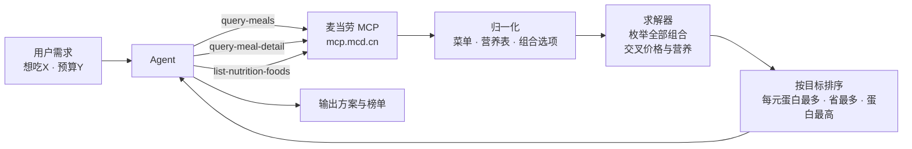

# 麦麦参考榜

> **麦当劳点餐是一道组合优化题，但没人替你算。**

¥14.9 的随心配有 **128 种搭法**，最优的一种每 ¥1 能拿到 **2.01g** 蛋白质；
¥33.5 的三件套有 **780 种搭法**，选得好相对单点能省 **¥20.1**。

用户凭感觉点，算不出这些。这个项目把「**这一顿怎么点最值**」变成一道可求解的题。

麦当劳程序员创意开发大赛参赛作品 · **非麦当劳官方产品** · 输出为客观数据对比，不构成医疗或营养建议。

---

## 实测数字

以下均为 MCP 实时数据计算结果，门店为上海静安寺餐厅。

| 场景 | 结果 |
|---|---|
| 随心配 ¥14.9 最优搭配 | 双层吉士汉堡 + 迷你朱古力新地 → **30g 蛋白质**，每 ¥1 可得 2.01g |
| 随心配 ¥14.9 最省搭配 | 高达吉士双牛堡 + 锡兰红茶 → 相对单点 **省 ¥20.1** |
| 三件套 ¥33.5 最省搭配 | 板烧鸡腿堡 + 中薯条 + 多汁柠柠 → 套餐 ¥35.5，单点需 ¥50.0 |
| 营养覆盖率 | 门店在售 128 项中 **59 项**可匹配官方营养表（46.1%） |
| 营养表规模 | 全量 161 项 |

---

## 它是怎么工作的



取数交给 MCP，算术交给求解器，表达交给 Agent。

---

## 榜单结构

按职责分三层，而不是把功能平铺：

| 层级 | 榜单 | 作用 |
|---|---|---|
| **核心** | 组合配置方案 | 直接给答案：枚举套餐全部搭配并求解最优解 |
| **支撑** | 套餐逐项拆解 | 每项的单点价 vs 套餐内加价 |
| **支撑** | 蛋白质性价比 | 按每 ¥1 可得蛋白质克数排序（含钠值视图 Tab） |
| **支撑** | 场景方案 | 预算内 / 多人分享 / 一份管饱 |
| **上下文** | 此刻可点 | 哪些门店现在营业 |
| **上下文** | 我的常点 | 复购频次与券、积分到期 |

合计串联 **11 个 MCP Tool**，跨越营养、价格、门店、订单、积分、券、活动、套餐组合八个数据域。

### 关于单位

榜单**不用抽象比率作主视觉**。每一行只给两个绝对值 —— **实付价（¥）** 与 **蛋白质克数（g）**。

排序依据统一表述为「**每 ¥1 可得多少克蛋白质**」。

此前使用的「每百元蛋白密度」是分析师口径 —— 普通用户无法直觉理解，而且它会和实际摄入量并列出现（同一行同时显示 171.4g 与 24.0g 两个"蛋白"数字），让读者无从判断哪个是自己吃到的。现已全部移除，比率只在榜单表头说明一次。

### 组合求解器怎么工作

```
query-meal-detail(code, storeCode)
        ↓  data.rounds[]        每个选择区（如「蓝区」「主食任意选」）
           └ choices[]          该区全部可选项 + 加价浮动（±¥1）
        ↓
笛卡尔积枚举：蓝区 8 选 1 × 粉区 16 选 1 = 128 种组合
        ↓
交叉 query-meals 的单点价 + list-nutrition-foods 的蛋白质
        ↓
按目标求解：每元蛋白最多 / 相对单点省最多 / 蛋白质合计最高 / 不加价最优
```

`rounds[].choices[]` 是这套能力的基础。榜单上 57 个提交项目都停在菜单列表层，没有项目用过这一层数据。

---

## 为什么做这个

大众点评式的榜单依赖用户打分，有三个问题：冷启动需要社区规模、全网热度数据无从获取、「好吃」这种主观口味没有客观数据源能推导。

所以换了个思路：**保留「卡片化榜单 + 多维排序」的体验，把填充数据换成 MCP 真实能给的客观数据**，并进一步从「呈现数据」推进到「给出方案」。

---

## 长列表怎么处理

蛋白质性价比榜匹配后可达 59 项，钠值视图涉及全量 161 项。处理方式：

- **分档 Tab**：按价位分档（≤¥20 / ¥20–30 / >¥30），钠值视图按数值区间
- **前三名大卡 + 后续紧凑行**：前 3 名展示完整数据与数据条，第 4 名起只保留名称与两个数值
- **数据条只在前三名出现**：实测 4 名以后差异很小，条形长度几乎相同，不携带信息、只是视觉噪音
- **切换过渡**：Tab 切换走 CSS `:checked`（宿主剥离脚本时仍能切换），另附脚本接管容器高度过渡
- **尊重减弱动效**：检测 `prefers-reduced-motion`，用户关闭动效时不播高度动画

---

## 实测数据示例

以下为真实拉取结果（上海静安寺店，2026-10-09）：

| 排名 | 餐品 | 实付价 | 蛋白质 | 蛋白密度 |
|---|---|---|---|---|
| 1 | 那么大鸡排（椒盐风味） | ¥14.00 | 24.0g | 171.4g / 百元 |
| 2 | 双层吉士汉堡 | ¥23.00 | 27.0g | 117.4g / 百元 |
| 3 | 麦辣鸡腿汉堡 | ¥22.50 | 24.0g | 106.7g / 百元 |
| 4 | 巨无霸 | ¥26.00 | 27.0g | 103.9g / 百元 |
| 5 | 麦香鸡 | ¥17.00 | 15.0g | 88.2g / 百元 |

---

## 关于数据覆盖率

**这是本项目最想让你注意的一件事。**

官方营养成分表共 158 项，而门店实时菜单有 122 项。两者存在版本差 —— 新品可能已上架但营养表尚未收录。

实测匹配结果：**63 / 122，覆盖率 51.6%**。

本项目的处理方式：

- 只对能确认对应的餐品计算指标
- 匹配不上的**显式标注「暂无营养数据」**，排在榜单末尾独立分组
- **绝不猜测映射** —— 不做模糊推断，不手工维护映射表
- 覆盖率在榜单顶部**常驻显示**，不可折叠

宁可少算，不可错算。一个假装 100% 覆盖的榜单，不如一个诚实标注缺口的榜单可信。

---

## 形态说明：为什么不做「端」的选择

活动规则对项目形态**没有任何平台限制**。规则原文将项目定义为：

> 基于麦当劳 MCP 能力开发的创新 Skill（能够实现信息查询、业务处理、决策辅助、内容生成、任务执行等目的的**应用程序、智能体、插件、自动化流程、工作流或其他软件功能模块**）

提交物清单中的源代码一项也写明「**形式不限**」。

所以本项目不针对 PC / 移动做分支，而是**容器自适应**。原因是真正的约束不在「端」，而在**宿主容器**：

- 规则要求「真实使用麦当劳 MCP 能力」，而 MCP 只能运行在 MCP Client 里
- 同一份输出可能渲染在对话流（约 400px）或产物面板（可达 1200px）
- 因此统一采用「**窄容器吃满宽度，宽容器居中定宽**」策略，一份代码在所有宿主里成立

| 形态 | 是否采用 | 原因 |
|---|---|---|
| **MCP Skill**（当前） | ✅ | 唯一能真实跑通 MCP 的形态 |
| MCP Client 输出区 | ✅ 主渲染面 | Skill 的原生宿主 |
| 独立 H5 | ✅ 可选 | 输出为完整 HTML 文档，可直接打开用于查看与截图 |
| 微信小程序 | ❌ | 小程序沙箱内跑不了 MCP Skill；且 Token 需下放前端，有泄露风险 |

### 容器适配实现

| 项 | 做法 |
|---|---|
| 输出 | 默认输出完整 HTML 文档（含 `viewport`），`--fragment` 输出纯片段供宿主包裹 |
| 宽度 | `width:100%; max-width:480px`（总览榜 760px），窄屏吃满、宽屏居中 |
| 栅格 | 总览榜用 `repeat(auto-fit, minmax(210px,1fr))`，窄屏 1 列、宽屏 2 列，无媒体查询 |
| 触摸目标 | 主按钮 44px，满足 WCAG 2.5.5 与 iOS HIG |
| 安全区 | 使用 `env(safe-area-inset-*)`，适配全面屏 |
| 字体缩放 | `-webkit-text-size-adjust:100%`，避免移动端字号被强制放大 |
| 资源 | 零图片、零外部字体，无加载阻塞 |

---

## 安装

需要 Node.js 18+。

```bash
git clone https://github.com/LinBoomBoom/mcd-metric-board.git
cd mcd-metric-board
npm install
npm run build
```

## 配置

申请麦当劳 MCP Token：<https://open.mcd.cn/mcp>（登录 → 控制台 → 激活 → 同意协议）

配置方式二选一：

**方式一 · 环境变量（推荐）**

```bash
export MCP_TOKEN="你的 Token"
```

**方式二 · 配置文件**

复制 `mcp-config.example.json` 为 `mcp-config.json` 并填入 Token。该文件已在 `.gitignore` 中被排除，不会被提交。

> ⚠️ 真实 Token 请勿写入代码、README 或任何提交到仓库的文件。

### 可选环境变量

| 变量 | 默认值 | 说明 |
|---|---|---|
| `MCP_TOKEN` | — | 必填 |
| `MCP_URL` | `https://mcp.mcd.cn` | MCP Server 地址 |
| `MCD_STORE_CODE` | `1450002` | 门店编码 |
| `MCD_STORE_NAME` | `上海静安寺餐厅` | 门店名称 |
| `MCD_CITY` | `上海` | 城市 |
| `MCD_KEYWORD` | `静安寺` | 关键词 |
| `MCD_LON` / `MCD_LAT` | 静安寺坐标 | 经纬度 |

## 使用

```bash
npm run all        # 完整报告：全部榜单渲染到一页
npm run board      # 总览榜（导航）
npm run protein    # 每百元蛋白密度榜
npm run combine    # 组合配置方案（随心配求解器）
npm run breakdown  # 套餐逐项拆解（盈亏平衡）
npm run scenario   # 场景方案
npm run now        # 此刻可点榜
npm run sodium     # 钠值分布榜
npm run mine       # 我的常点榜
npm run probe      # 验证 MCP 连通性
```

各榜单输出为**完整 HTML 文档**，可直接在浏览器打开，也可被宿主容器嵌入。
追加 `--fragment` 只输出样式与榜单片段：

```bash
node dist/cli.js protein --fragment
```

---

## MCP Server 配置

```json
{
  "mcpServers": {
    "mcd-mcp": {
      "type": "streamablehttp",
      "url": "https://mcp.mcd.cn",
      "headers": {
        "Authorization": "Bearer ${MCP_TOKEN}"
      }
    }
  }
}
```

接入地址 `https://mcp.mcd.cn`，Streamable HTTP 协议，限流 600 次/分钟。详见 [麦当劳 MCP Server 使用指南](https://github.com/M-China/mcd-mcp-server)。

---

## 目标用户

- 想点餐但懒得翻长菜单的人 —— 看一眼排序就知道该点哪个
- 关心预算的人 —— 券后实付价折算，比看原价更准
- 想知道数据从哪来的人 —— 每个数字都可追溯到官方接口，不做推测

## 设计取舍

**为什么不做「低脂榜」「健康榜」？**

规则禁止宣扬不健康饮食方式，而任何健康评判类表述都存在合规风险。因此：

- 色阶只用**单色阶**（浅→深），不用红绿对比 —— 红绿在中国饮食语境意味着「警告 / 健康」，构成健康评判
- 钠值榜给**全菜单百分位**作参照系，而不是「高 / 低」的评价
- 所有营养相关表述一律为客观数据陈述

**为什么主界面不用麦当劳品牌色？**

官方声明要求「非麦当劳官方产品」。使用品牌色会造成官方误认，且与同赛道项目撞色无差异化。本项目采用中性深灰基调。

**「我的常点榜」的隐私怎么处理？**

个人数据仅在运行时计算，不存储、不上传、不写入任何文件。榜单顶部常驻标注此承诺。

---

## 开发中踩的坑

记录下来供参考：

| 坑 | 表现 | 解法 |
|---|---|---|
| MCP 响应三层嵌套 | `result.content[0].text` 里再套 markdown + JSON，`data` 常是字符串化数据 | 优先读 `result.structuredContent` |
| `query-meals` 参数 | `orderType` 和 `beType` **都必传**，漏一个报 400 | 默认走 `beType=1` |
| `beType` 场景限制 | `beType=2/5/6` 时还须传 `beCode` | 仅走 `beType=1` 通用场景 |
| 门店打烊报错 | `code 600057 门店可能已关闭或不在营业时间` | 调用前用营业时间预判，捕获后降级 |
| `query-nearby-stores` 空结果 | `searchType=1`（收藏）时收藏列表为空 | 改用 `searchType=2` + 城市 + 关键词 + 经纬度 |
| 菜单数据结构 | `data.categories[]` 里只有编码，名称价格都在 `data.meals` | `meals` 是以编码为键的对象 |
| 餐名不一致 | 「麦辣鸡腿堡」在营养表里叫「麦辣鸡腿汉堡」 | 三级降级匹配，仅用「去括号」一种归一化规则 |

---

## 合规设计

规则对内容合规的要求较严，违规可被取消资格。因此项目内置了自动检查：

- **禁用词表**：健康 / 低卡 / 高蛋白餐 / 健身首选 / 减肥 / 热量控制 / 低脂 / 燃脂 / 轻食等
- **品牌对比扫描**：出现其他餐饮品牌即拦截
- **输出前强制校验**：所有榜单在渲染后、输出前自动扫描，命中则阻止输出

开发中这个守卫真的拦下过一次 —— 「不代表健康程度」这句里的「健康」二字即使是否定用法也会被判定风险，已改为「仅表示蛋白含量高低程度」。

宁可漏输出，不可错输出。

---

## 许可

MIT License

本项目为麦当劳程序员创意开发大赛参赛作品，由参赛者独立开发，非麦当劳官方产品。使用麦当劳 MCP 服务须遵守[麦当劳 MCP 服务规则](https://cdn.mcd.cn/cms/pages/MCPServerRules.html)。
